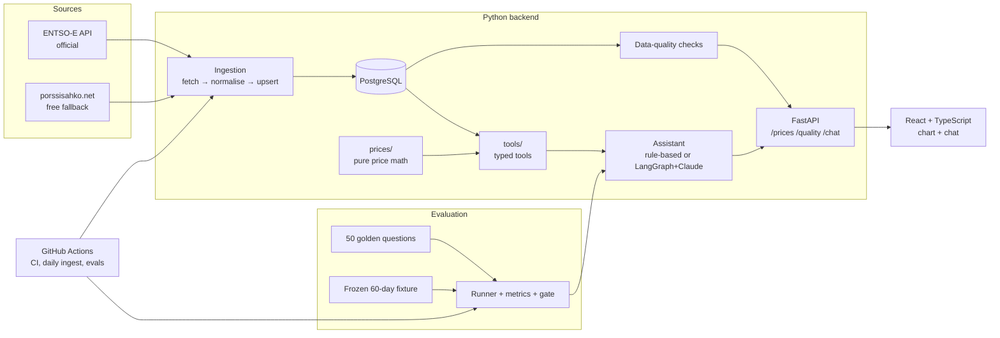

# SpotWise FI

**Finnish electricity spot prices, checked and explained.** SpotWise fetches the official
day-ahead prices every day, checks the data for problems, and answers questions like
*"When is the cheapest 3-hour window to charge my car tomorrow?"*. Every number in an
answer comes from tested code, never from a guess.

**Live demo:** _add your Netlify URL here after deploying (see [docs/DEPLOY.md](docs/DEPLOY.md))_

<!-- Add a 20–30 s screen recording here: docs/demo.gif -->
<!--  -->

[](https://github.com/AbdulZeeshan688/spotwise-fi/actions/workflows/ci.yml)

## What it does
- **Daily ingestion** of FI day-ahead prices (ENTSO-E, with porssisahko.net as a free fallback), 15-minute and hourly resolution, idempotent and DST-safe.
- **Data-quality checks** after every run: completeness (23/24/25-hour days), duplicates, price spikes (median/MAD), late publication, negative prices.
- **Price tools**: cheapest/most expensive window, statistics, period comparison, cost estimates. Pure, `Decimal`-based, property-tested.
- **Assistant**: answers questions by calling those tools. It refuses off-topic questions and never guesses unpublished prices. By default it is a free **rule-based** agent; an optional **LangGraph + Claude** agent uses the same tools.
- **Evaluation harness**: 50 golden questions on a frozen 60-day fixture of real prices. Ground truth is computed by code, and a regression gate runs in CI on every push.
- **Web app**: price chart for today and tomorrow, streaming chat, data-quality badge. Mobile and dark-mode friendly, always in Finnish time.

## Architecture



**Hosting (all free):** web app on Netlify, API in Docker on Render, Postgres on Neon, daily ingest on GitHub Actions.

## Evaluation results

Latest run: 50 questions, 60 days of real prices, frozen clock 2025-11-15 10:00 Helsinki
(full report: [`evals/reports/`](evals/reports/)).

| Metric | Result | Target |
|---|---|---|
| Numeric accuracy (questions with numbers) | **100%** | ≥ 90% |
| Refusal accuracy (off-topic / unavailable data) | **100%** | ≥ 95% |
| On-topic questions wrongly refused | **0%** | 0% |
| Correct tools called | **100%** | |
| Answers with numbers not from tools | **0** | 0 |
| Cost per run | **$0** | |

*Honest note:* the rule-based parser was written while looking at these questions, so
this measures "works on what it was built for". A held-out set of rephrased questions is
the next step (see below).

## Run it locally

Requirements: Python 3.12 with [uv](https://docs.astral.sh/uv/), Node 20+, PostgreSQL 16
(Docker: `docker compose up -d db`).

```bash
cp .env.example .env                       # defaults work for local Docker Postgres
uv sync
uv run alembic upgrade head
uv run python -m spotwise.ingest.cli backfill --days 3   # fetch some prices
uv run uvicorn spotwise.api.main:app --reload            # API on :8000, docs at /docs

cd web && cp .env.example .env && npm install && npm run dev   # app on :5173
```

Tests and checks:

```bash
uv run pytest            # backend (DB tests skip if Postgres isn't running)
uv run ruff check . && uv run mypy
uv run python -m evals.runner --suite golden --agent rules   # eval (needs Postgres)
cd web && npm test && npm run build
```

Shortcuts for these commands are in the [Makefile](Makefile).

## Design decisions
The short version (full list in [docs/DECISIONS.md](docs/DECISIONS.md)):
- **Math in code, words in the assistant.** No number is ever generated; tools return them and a guardrail checks them.
- **UTC inside, Helsinki outside; DST-aware everywhere.** Days have 23–25 hours and 92–100 quarter-hour prices.
- **Frozen fixture + frozen clock for evals**, with ground truth independent of the tools. A test proves that a VAT bug in a tool fails the gate.
- **Free by design.** The default assistant is rule-based, all hosting is on free tiers, and evals run in CI on every push.

## Cost & limits
- **€0 to run.** No paid APIs; Netlify, Render, Neon and GitHub Actions free plans.
- The free API **sleeps when idle**: the first visit after ~15 minutes takes 30–60 s (the app says so).
- **Prices exclude transfer fees and electricity tax**; VAT 25.5% is included by default.
- **Finland only**, day-ahead prices only, no forecasting.
- Without an ENTSO-E token, history comes from porssisahko.net one price at a time (slow backfills).

## What I'd do next
- A **held-out eval set** of rephrased questions that the parser is never tuned against.
- A **free local LLM** (e.g. via Ollama) as a third agent mode, compared on the same eval.
- Configurable **tariffs** (transfer fees, electricity tax) for real total costs.
- Finnish-language UI.

## Project docs
- [docs/PROJECT_BRIEF.md](docs/PROJECT_BRIEF.md): requirements and roadmap
- [docs/DEPLOY.md](docs/DEPLOY.md): free deployment, step by step
- [docs/DECISIONS.md](docs/DECISIONS.md): why things are built this way
- [docs/phases/](docs/phases/): what each phase built and how it was verified
