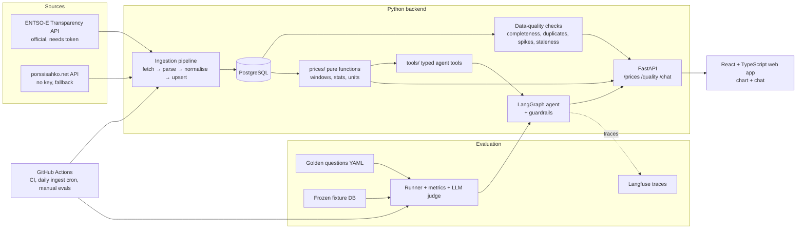

# SpotWise FI — Project Brief

Working name: **SpotWise FI** (rename any time).
Owner: Abdul Zeeshan Mirza · Lahti, Finland
Goal: a portfolio project that proves junior-level skills in **data pipelines, data quality, AI agents with tools, AI evaluation, and full-stack delivery**, built on real Finnish data.

---

## 1. The idea in one paragraph

Finland's electricity price changes every 15 minutes and is published a day ahead. Many people (EV owners, heat-pump users, people on spot contracts) want to know *when* to use electricity. SpotWise FI pulls the official prices every day, checks the data for problems, and lets you ask questions in plain English, like "When is the cheapest 3-hour window to charge my car tomorrow?". An AI agent answers by calling exact, tested tools, never by guessing. A built-in evaluation harness measures how often the agent is right.

## 2. Why this project (what it proves to employers)

| Employer need seen in real job ads (Oct 2026) | Where SpotWise shows it |
|---|---|
| Production data pipelines, messy real-world data (IPRally, EOS, Virta) | Phase 2 ingestion, Phase 3 quality checks |
| Agents with tool use, guardrails, safe fallbacks (If, IPRally) | Phase 5 LangGraph agent |
| AI evaluation: test sets, regression tests, LLM-as-judge, tracing (If, IPRally) | Phase 6 evaluation harness + Langfuse |
| Python, FastAPI, Pydantic, pytest (If, EOS) | Whole backend |
| React, TypeScript, testing (Smartly) | Phase 7 web app |
| Energy / industrial domain (Capalo AI, EOS) | The domain itself |
| CI/CD, Docker, cloud deployment | Phases 1 and 8 |

## 3. Users and main use cases

Primary user: a person in Finland on a spot-price electricity contract.

1. "What's the price right now?"
2. "When is the cheapest 3-hour window today / tomorrow?" (EV charging, laundry, sauna)
3. "What were the cheapest and most expensive hours this week?"
4. "How does this week compare to the same week last month?"
5. "If I charge 40 kWh tonight between 22 and 06, roughly how much does it cost?"
6. "Were there negative prices this month? When?"
7. "Is tomorrow's price published yet?"

Secondary user: a recruiter or engineer reading the repo, who should understand it in 2 minutes from the README.

## 4. Scope

### In scope for v1
- Finland only (bidding zone FI).
- Day-ahead spot prices, 15-minute and hourly resolution, about 2 years of history.
- Daily automatic ingestion + data-quality report.
- Price tools (pure, tested functions) exposed to the agent and as REST endpoints.
- LangGraph agent with tools, guardrails and streaming answers.
- Evaluation harness: 50+ golden questions, deterministic ground truth, metrics, LLM-as-judge for answer quality, Langfuse tracing, a markdown report.
- Web app: price chart for today and tomorrow plus a chat panel.
- Deployed demo + README with architecture diagram and eval results.

### Out of scope / v2 (do NOT build in v1)
- Other countries or zones, intraday market, imbalance prices.
- User accounts or logins, saving personal usage data.
- Price forecasting with ML (v2 idea: forecast beyond day-ahead).
- Real device control (charger or heat pump APIs).
- Finnish-language UI (v2: add `fi` translations).
- Grid transfer fees (siirtohinta) and electricity tax (v2: configurable tariff).
- Mobile app.

## 5. Architecture



**Design principles**
1. **Math in code, words in the LLM.** All calculations live in `prices/` as pure Python functions with tests. The agent only decides which tool to call and how to explain the result.
2. **Deterministic evaluation.** Evals run against a frozen fixture database, so ground-truth answers never change and results are comparable over time (same idea as RERUN's replayable runs).
3. **Idempotent pipeline.** Running ingestion twice gives the same database.
4. **UTC inside, Helsinki outside.**

## 6. Data sources

| Source | Auth | Format | Use |
|---|---|---|---|
| ENTSO-E Transparency Platform REST API | Free security token (request at transparency.entsoe.eu) | XML (Publication_MarketDocument) | **Primary.** Day-ahead prices (documentType A44), domain FI, history for backfill. |
| porssisahko.net public API | None | JSON | **Fallback / quick start** while waiting for the ENTSO-E token. |

**Important:** during Phase 2 research, Claude must check the *current* endpoints and response formats of both APIs (they changed when the market moved to 15-minute prices in autumn 2025). Don't trust remembered URLs; check the docs.

ENTSO-E notes:
- FI bidding-zone EIC code: `10YFI-1--------U`.
- Prices are €/MWh. The XML can contain `PT15M` (15-minute) or `PT60M` (hourly) periods; parse the `resolution` field, and handle positions that are omitted when the price repeats (curve type A03).

## 7. Data model (PostgreSQL)

```sql
-- prices: one row per price slot
CREATE TABLE prices (
  id                 BIGSERIAL PRIMARY KEY,
  area               TEXT        NOT NULL DEFAULT 'FI',
  ts_start           TIMESTAMPTZ NOT NULL,          -- UTC
  resolution_minutes SMALLINT    NOT NULL CHECK (resolution_minutes IN (15, 60)),
  price_eur_mwh      NUMERIC(10,3) NOT NULL,        -- can be negative
  source             TEXT        NOT NULL,          -- 'entsoe' | 'porssisahko'
  fetched_at         TIMESTAMPTZ NOT NULL DEFAULT now(),
  UNIQUE (area, ts_start, resolution_minutes)
);
CREATE INDEX ON prices (area, ts_start);

-- ingestion_runs: audit log of every pipeline run
CREATE TABLE ingestion_runs (
  id             BIGSERIAL PRIMARY KEY,
  started_at     TIMESTAMPTZ NOT NULL,
  finished_at    TIMESTAMPTZ,
  source         TEXT NOT NULL,
  date_from      DATE NOT NULL,
  date_to        DATE NOT NULL,
  rows_upserted  INTEGER,
  status         TEXT NOT NULL,      -- 'success' | 'partial' | 'failed'
  error          TEXT
);

-- quality_results: one row per check per day
CREATE TABLE quality_results (
  id          BIGSERIAL PRIMARY KEY,
  run_at      TIMESTAMPTZ NOT NULL DEFAULT now(),
  day         DATE NOT NULL,          -- Helsinki-local day being checked
  check_name  TEXT NOT NULL,          -- completeness | duplicates | spikes | staleness | negative_prices
  status      TEXT NOT NULL,          -- 'pass' | 'warn' | 'fail'
  details     JSONB NOT NULL DEFAULT '{}'
);
```
A SQL view `prices_hourly` gives hourly averages (from quarters when 15-minute data exists).

## 8. Requirements (with IDs)

### DATA — ingestion
- **DATA-01** Fetch FI day-ahead prices for a date range from ENTSO-E.
- **DATA-02** Fetch the same from porssisahko.net (fallback when the ENTSO-E token is missing or the API fails).
- **DATA-03** Parse both 15-minute and hourly resolutions correctly, including DST days (23 and 25 hours) and omitted repeated positions.
- **DATA-04** Upsert idempotently; re-running a range never creates duplicates.
- **DATA-05** CLI: `backfill --days N` and `daily` (today + tomorrow if published).
- **DATA-06** Log every run in `ingestion_runs` with status and row count.
- **DATA-07** Daily scheduled run via GitHub Actions cron (after prices are published, early afternoon Finnish time, plus one retry later).

### DQ — data quality
- **DQ-01** Completeness: expected slot count per Helsinki-local day (DST-aware) vs actual.
- **DQ-02** Duplicates / overlapping resolutions for the same time.
- **DQ-03** Spikes: flag prices far outside the rolling 30-day distribution (warn, don't fail).
- **DQ-04** Staleness: tomorrow missing after the expected publication time → warn.
- **DQ-05** Negative prices are recorded as info, never as failures.
- **DQ-06** Results saved to `quality_results`; `GET /quality/latest` returns a summary.

### PRICE — price logic (pure functions)
- **PRICE-01** Unit conversion €/MWh → c/kWh, with/without VAT (VAT rate from config, default 25.5%).
- **PRICE-02** Cheapest contiguous window of length D (15-minute steps) within a time range.
- **PRICE-03** Most expensive window (same logic).
- **PRICE-04** Stats for a range: min, max, mean, median, count of negative slots, with timestamps.
- **PRICE-05** Compare two ranges (mean difference in absolute and percent terms).
- **PRICE-06** Cost estimate: kWh spread evenly over a window → total € incl./excl. VAT.
- **PRICE-07** All functions are property-tested (hypothesis), e.g. the cheapest window is never more expensive than any other window of the same length.

### API
- **API-01** `GET /health`
- **API-02** `GET /prices?from=&to=&resolution=15|60&vat=true|false`
- **API-03** `GET /prices/cheapest-window?date=&hours=`
- **API-04** `GET /quality/latest`
- **API-05** `POST /chat` with streaming (Server-Sent Events) and a `session_id` for short conversation memory.
- **API-06** CORS limited to the frontend origin; simple rate limit on `/chat`.

### AGENT
- **AGENT-01** LangGraph graph: understand → call tools (loop allowed, max 5 tool calls) → answer.
- **AGENT-02** Tools: `get_current_price`, `get_prices`, `find_cheapest_window`, `find_most_expensive_window`, `get_price_stats`, `compare_periods`, `estimate_cost`, `check_data_availability`.
- **AGENT-03** Relative dates ("tomorrow", "this week", "last month") are resolved in Europe/Helsinki by a helper, not by the LLM.
- **AGENT-04** Guardrails: off-topic refusal; never state a number not returned by a tool; say clearly when data isn't available yet.
- **AGENT-05** Every answer states the time range used and whether VAT is included.
- **AGENT-06** Model and temperature from config; temperature 0 for evals.
- **AGENT-07** Langfuse tracing of every run (when keys are set).

### EVAL
- **EVAL-01** Golden dataset: 50+ questions in YAML (see `EVAL_SEED_QUESTIONS.md`), each with category, expected tool(s), and a ground-truth function or value.
- **EVAL-02** Frozen fixture DB snapshot (e.g. 60 days, including at least one DST day and some negative prices) loaded before evals.
- **EVAL-03** Metrics per question: tool-selection correctness, numeric correctness (with tolerance), refusal correctness, latency, tokens/cost.
- **EVAL-04** LLM-as-judge for answer quality (clarity, mentions range and VAT, no made-up numbers), scored 1–5 against a written rubric.
- **EVAL-05** Report written to `evals/reports/<date>.md` with a summary table, plus a JSON file for comparing runs.
- **EVAL-06** Regression gate: the eval workflow fails if numeric accuracy drops below a threshold (start at 90%).
- **EVAL-07** Manual GitHub Action `evals.yml` (workflow_dispatch) so evals don't cost money on every push.

### UI
- **UI-01** Chart of today's and tomorrow's prices (15-minute bars, hourly toggle), c/kWh incl. VAT by default, with the current slot highlighted.
- **UI-02** Chat panel with streaming answers and example-question chips.
- **UI-03** "Data quality" badge (green/yellow/red) from `/quality/latest`.
- **UI-04** Works on mobile width, keyboard accessible, dark-mode friendly.
- **UI-05** Vitest tests for the main components; typed API client.

### OPS
- **OPS-01** Docker Compose for local Postgres (and optionally the API).
- **OPS-02** CI on every push: ruff, mypy, pytest (backend), vitest + build (frontend).
- **OPS-03** Deployed backend (Render or Fly.io) + managed Postgres (Neon or Supabase free tier) + frontend on Netlify.
- **OPS-04** Secrets only in environment variables / GitHub secrets.

### DOC
- **DOC-01** README: one-line pitch, demo link, GIF, architecture diagram, how to run locally, eval results table, design decisions, what I'd do next.
- **DOC-02** `docs/DECISIONS.md`: short notes on key decisions (why LangGraph, why a frozen fixture DB, why 15-minute storage, …).

## 9. Roadmap — milestone v1.0 (8 phases)

| # | Phase | Requirements | Done when… | Est. |
|---|---|---|---|---|
| 1 | **Foundation** | OPS-01, OPS-02, API-01 | Repo structure, uv project, Docker Postgres, Alembic schema, `/health`, CI green | 1 evening |
| 2 | **Ingestion pipeline** | DATA-01…07 | `backfill --days 730` fills the DB; re-running adds 0 rows; DST days correct; daily cron works | 2–3 evenings |
| 3 | **Data quality** | DQ-01…06, API-04 | Checks run after ingestion; `/quality/latest` returns results; tests cover DST, gaps, duplicates, spikes | 1–2 evenings |
| 4 | **Price tools** | PRICE-01…07, API-02, API-03 | Pure functions + endpoints, property tests pass | 2 evenings |
| 5 | **Agent** | AGENT-01…07, API-05, API-06 | `/chat` streams correct answers to the 7 use cases; guardrails work | 2–3 evenings |
| 6 | **Evaluation harness** | EVAL-01…07 | `evals.runner` produces a report; accuracy ≥ 90% numeric; the gate works in CI | 2–3 evenings |
| 7 | **Web app** | UI-01…05 | Chart + chat work locally against the API; tests pass | 2–3 evenings |
| 8 | **Deploy & polish** | OPS-03, OPS-04, DOC-01, DOC-02 | Public demo URL, README done, eval table in README, LinkedIn post drafted | 1–2 evenings |

Phase order is fixed: each phase depends on the one before. Phase 7 can start after Phase 4 if you want a break from AI work (it only needs `/prices`).

## 10. Definition of done for v1.0
- [ ] Public demo link works on phone and laptop.
- [ ] Daily ingestion has run successfully for 3 days in a row.
- [ ] Eval report shows ≥ 90% numeric accuracy and ≥ 95% correct refusals on the golden set.
- [ ] CI green on `main`.
- [ ] README has a GIF, diagram, eval table and "how I'd improve it".
- [ ] I can explain every phase in an interview in 2 minutes without notes.

## 11. Risks and how to handle them

| Risk | Plan |
|---|---|
| ENTSO-E token approval is slow | Start with porssisahko.net (DATA-02); switch the default source later. |
| API format changes (15-minute move) | Phase 2 research checks current docs; parser tests use real saved sample responses. |
| DST and timezone bugs | Dedicated tests for the last Sunday of March and October. |
| LLM invents numbers | Guardrail + eval metric "numbers not from tools" + temperature 0. |
| LLM costs | Cheap model for dev, evals only on manual trigger, spending limit in the console. |
| Scope creep | Anything new goes into the v2 list, not v1. |
| Running out of motivation | A deployed, ugly-but-working version at the end of week 3 beats a perfect unfinished one. |
